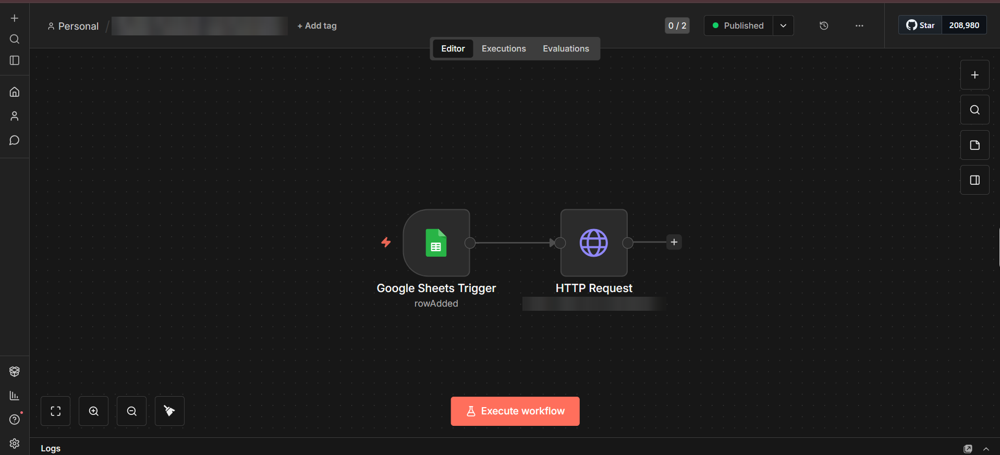
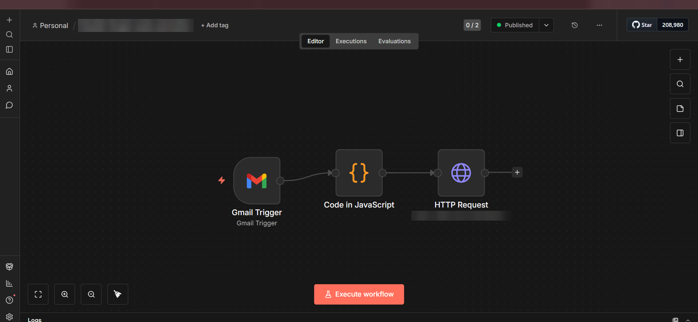
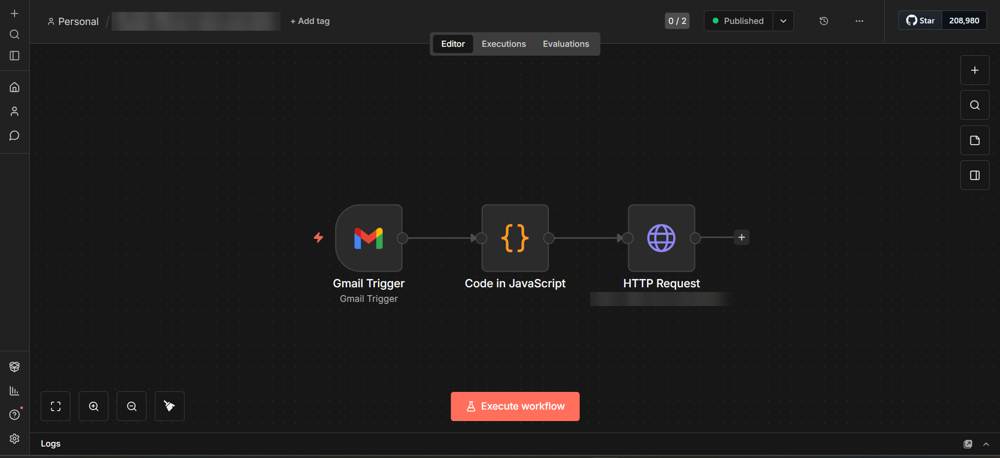

## Lead-Capture-Automation-Real-Estate-CRM-Case-Study
# Lead Capture Automation for a Real Estate CRM — Case Study

Client project case study: automatic lead capture from Facebook Lead Ads, Google Ads and a property portal straight into a real estate CRM — with source tagging, project detection and automatic assignment to the sales team — built with self-hosted n8n workflows and a secured CRM API.

## Overview

This is a client case study for a real estate developer in India. The client runs ad campaigns on several channels for different projects. Every new enquiry used to arrive in a different place — a Facebook lead sheet, an email notification, a portal inbox — and someone had to copy it into the CRM by hand and decide which salesperson should call. Leads were entered late, sometimes twice, and sometimes not at all.

I built a lead capture system that brings every enquiry into the CRM automatically within moments. Each lead is tagged with the correct source and sub-source, matched to the right project from the campaign or form it came from, and assigned to a salesperson using clear rules. As soon as the lead is created, the CRM's other automations (WhatsApp welcome message and AI voice call) take over.

## Live Website

Private internal system used by the client's sales team — no public demo.

## Project Type

Client Automation / CRM Integration

## Business Category

Real Estate Developer / Property Sales

## Key Features

* Facebook Lead Ads captured automatically into the CRM
* Google Ads leads parsed from notification emails
* Property portal (99acres) leads parsed from notification emails
* Correct source and sub-source tagging for every channel
* Project detection from the campaign or form name, with a safe default
* Customer requirements from the ad form (e.g. flat type) saved in the lead's notes
* Automatic assignment to salespeople
* Round-robin distribution so leads are shared fairly
* Strict turn-by-turn rotation for selected campaigns
* Project-specific assignment rules (e.g. one project always goes to a dedicated salesperson)
* Duplicate-safe assignment, even when several leads arrive at the same moment
* Secured inbound lead API protected with an API key
* New leads instantly visible in the CRM's All Leads list
* Automatic hand-off to the WhatsApp welcome message and AI voice call

## How It Works

**Facebook Lead Ads**

1. A customer submits a Facebook lead form.
2. The lead lands in a connected Google Sheet.
3. An n8n workflow (Google Sheets trigger → HTTP request) picks up each new row and sends it straight to the CRM's inbound lead API, which validates and cleans it.

**Google Ads and property portal leads**

1. The ad platform or portal emails a new-lead notification.
2. An n8n workflow (Gmail trigger → JavaScript → HTTP request) watches the inbox, and a JavaScript step reads the email and extracts the customer's name, phone, project and requirements.
3. The cleaned lead is sent to the CRM's inbound lead API.

**Inside the CRM**

1. The API checks the API key and matches the campaign/form name to a project (falling back to a default project).
2. The lead is tagged with its source and sub-source and assigned to a salesperson using the project's assignment rule.
3. The lead appears in All Leads, and the WhatsApp welcome and AI voice call start automatically.

## Challenges & Solutions

* **Different data formats per channel** — each channel has its own small workflow; email leads are converted by a JavaScript step, and the CRM's inbound API normalises everything into one standard lead format.
* **Reading leads out of emails** — extracted name, phone, project and requirements reliably from notification emails with different layouts.
* **Knowing which project a lead belongs to** — a mapping table links campaign and form names to projects, with a default so no lead is ever lost.
* **Fair distribution** — round-robin and strict rotation rules, protected with database row locking so two leads arriving together are never given out incorrectly.
* **Large incoming requests being rejected** — adjusted the web server's request limits so long sheet rows and email bodies are accepted.
* **Security** — the inbound API only accepts requests carrying the correct key.

## Tech Stack

* n8n (self-hosted workflow automation)
* Facebook Lead Ads
* Google Sheets
* Gmail (email lead parsing)
* Node.js
* Express.js (REST API)
* MySQL
* JavaScript
* Nginx + PM2 on a Linux VPS
* Claude-assisted development

## My Role

I worked on the complete lead capture setup: planning the channels and tagging with the client, building the n8n workflows for Facebook (via Google Sheets) and email-based Google Ads and portal leads, the email parsing logic, the secured inbound lead API in the CRM, the campaign-to-project mapping, the round-robin, strict-rotation and project-specific assignment rules with safe concurrent handling, and connecting the captured leads to the WhatsApp and AI calling automations. I used Claude to assist in building and improving the system for a real client project.

## Screenshots

### Facebook Lead Ads Workflow (n8n)

Google Sheets trigger (new row) → send to the CRM's inbound lead API.

### Google Ads Lead Workflow (n8n)

Gmail trigger (new lead email) → JavaScript parsing → send to the CRM's inbound lead API.

### Property Portal Lead Workflow (n8n)

Gmail trigger (portal lead email) → JavaScript parsing → send to the CRM's inbound lead API.

## Status

Completed and live — in daily use by the client's sales team.

## Confidentiality Note

This repository is a portfolio case study. The client's name, project names, CRM address, customer and lead data, phone numbers, email addresses, sheet names, campaign names, API keys, webhook URLs, account credentials, server details, and private source code are not included. Screenshots have identifying information hidden.
